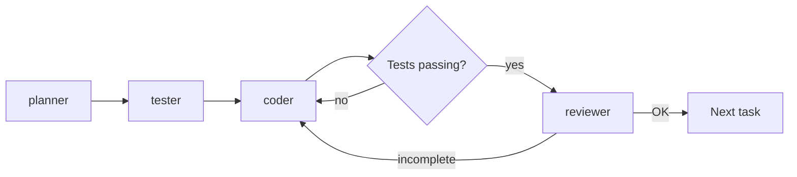

# CLAUDE.md

This file guides Claude Code when working in this repository. **These instructions
OVERRIDE default behavior — follow them exactly.**

> This is a template. Fill the `<...>` placeholders during project bootstrap (see
> [README.md](README.md) → *Bootstrap a new project*). Delete this quote block when done.

## Project

`<PROJECT_NAME>` — `<one-paragraph description: what it does, who it's for, the core
constraint (e.g. local-first / offline / has a backend)>`. **SPEC.md is the living
product spec — consult it before implementing features and update it on significant
design decisions.**

Docs are in English. `<If the UI is localized: user-facing strings live in <where> with
<which languages> — never hardcode user-facing strings in components. Otherwise delete
this sentence.>`

## Stack

> Fill this at bootstrap. Be specific — the agents read this section to know the stack.

- **Framework:** `<e.g. Vite + React 18 + TypeScript (strict)>`
- **UI / styling:** `<e.g. Tailwind CSS + shadcn/ui>`
- **Data layer:** `<e.g. local-first SQLite via @capacitor-community/sqlite (device) /
  sql.js (web); single access layer in data/. OR: Supabase. See Architecture.>`
- **Native packaging (if any):** `<e.g. Capacitor → iOS + Android. Or: none / web-only.>`
- **Tests:** `<e.g. Vitest — logic-only>`
- **Path alias:** `<e.g. @/* → src/*>`

## Commands

> Fill at bootstrap with this project's real commands. Agents run exactly these.

```bash
<install>        # e.g. npm install
<dev>            # e.g. npm run dev            — dev server
<test>           # e.g. npm test               — unit tests (logic-only)
<typecheck>      # e.g. npx tsc --noEmit        — strict type check
<build>          # e.g. npm run build
<native-sync>    # e.g. npx cap sync           — if using Capacitor
```

There is no lint script unless added. Unit tests cover **pure logic only** (the
data-access layer and pure utils); UI/native behavior is verified by running the app
(see [TESTING.md](TESTING.md)), not by component tests.

## Subagent pipeline & orchestration

Feature work uses four agents in `.claude/agents/` plus an **orchestrator** — the main
Claude session, invoked via the `/feature <description>` command. The orchestrator is
**read-only with respect to code**: per feature it runs **one cycle** — delegating the
roles below and looping on each gate. The plan's steps are the coder's checklist *within*
the cycle, not separate gate points:



- **planner** — read-only plan; lists the testable logic that drives the task loop.
- **tester** — writes the failing logic tests once (TDD red). Re-invoked **only** if a test
  encodes the wrong expectation — making red tests green is the coder's job, not the tester's.
- **coder** — implements until tests are green; owns the `no` loop. Re-invoked on the
  `incomplete` edge.
- **reviewer** — read-only gate: runs the test + type-check commands, plus a Playwright-MCP
  **browser smoke** of the affected flow when the change is browser-observable; verdict
  APPROVED (`OK` → next task) / CHANGES REQUIRED (`incomplete` → back to coder).

Drive it with `/feature <description>`, or run the same loop by hand. Use it for features
with **real logic or risk** — for a small, low-risk change (copy tweak, style fix,
one-liner), just make it directly and run the test + type-check commands; don't spin up the
whole pipeline. If a feature has no significant pure logic, the tester is skipped (the
planner flags this).

### Model routing (token policy)

Models are chosen **per feature, automatically**, to avoid paying Opus rates for cheap
work. The planner (always on opus — its judgment compounds) gives the feature one
complexity rating; the orchestrator runs the tester and coder on the routed model:

| Tag   | Feature is…                                                     | Model    |
|-------|-----------------------------------------------------------------|----------|
| `[S]` | trivial — pure mapping, a small local change, low risk          | `haiku`  |
| `[M]` | medium — typical feature logic across a few files               | `sonnet` |
| `[L]` | complex — schema/migration, cross-cutting, ambiguous, high-risk | `opus`   |

- **planner** and **reviewer** always run on **opus** (plan quality and the final gate are
  where mistakes are most expensive).
- **Escalation:** if the coder returns without green tests (stuck), the orchestrator
  re-spawns it on `opus` — firepower auto-bumps when the feature turns out harder than it
  looked. No per-step counting; just one escalation when the cycle stalls.
- Each agent's frontmatter `model:` is only the **default** (used when run directly,
  without the orchestrator); the per-task override above takes precedence under `/feature`.

This relies on the `Agent`/`Task` tool accepting a per-invocation `model` override. If a
setup doesn't support that, fall back to per-tier agent variants (e.g. `coder-light` on
sonnet, `coder-heavy` on opus) and route by choosing which to invoke.

## Architecture

**Data flow — `<describe the state strategy, e.g. deliberately no global store: each
screen loads in an effect, mutates via the data layer, then reloads>`.**

**The single data-access layer.** All reads/writes go through one layer (`<e.g. data/>`).
Don't scatter raw queries/storage calls across the UI. This is what makes the backend
swappable (e.g. local-first ↔ a hosted backend) — the rest of the app depends on the
layer's functions, not on where the data physically lives.

**Layers (fill at bootstrap):**
- `<src/ — app code: routes/pages, components>`
- `<data/ — the only data-access layer>`
- `<components/ui/ — reusable base UI kit>`
- `<utils/ — pure helpers (unit-tested)>`
- `<constants/ or theme — design tokens; never hardcode style values when a token exists>`

**Migrations / schema changes (if the data layer has a schema):** `<describe the pattern
— e.g. hand-written DDL run at startup; any schema change edits both the schema types and
the migration>`.

## Domain rules

> Fill at bootstrap and grow over time. These are the project-specific invariants the
> Reviewer enforces. Examples of the *kind* of rule to capture:

- `<e.g. Deleting X sets Y to null — children survive.>`
- `<e.g. Deletes are deferred behind a 5s Undo; don't add immediate deletes in screens.>`
- `<e.g. The only required form field is the title; numeric fields save an int ≥ 1 or
  null — never NaN.>`
- `<e.g. Search must handle non-ASCII input — filter in JS, not SQL LIKE.>`
- Out-of-scope features are listed in `SPEC.md` → **Out of scope** — don't add them
  speculatively.
