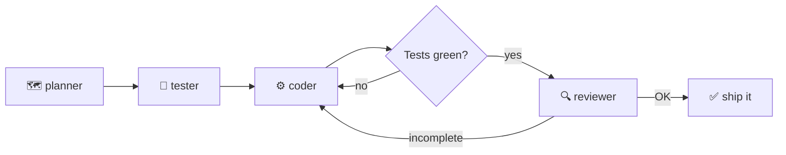
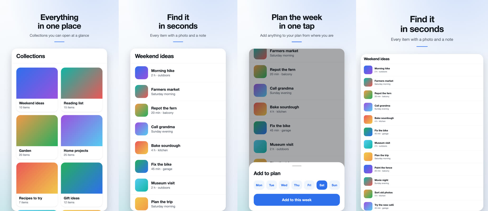
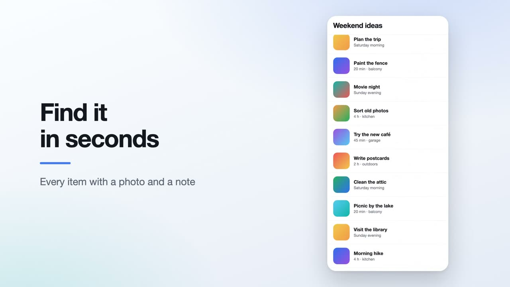

# ai-starter

**Ship features with an AI pipeline that plans, tests, codes, and reviews — you bring the stack.**

ai-starter is a stack-agnostic template for building apps with [Claude Code](https://claude.com/claude-code).
It ships **zero application code**. What it ships instead is the thing that's actually hard
to get right: a *disciplined way of working with AI* — a four-agent pipeline with quality
gates, living docs that keep the AI on-spec, and guardrails that make it mechanically
impossible to end a session with red tests.

> Extracted and generalized from a real production project —
> [KeepTaste](https://play.google.com/store/apps/details?id=com.damianmalecki.keeptaste),
> a recipe manager built this way and shipped to Google Play — and updated with what that
> project taught afterwards (see [Field notes](#field-notes)). The value is the
> **methodology**, not a framework — which is exactly why it works across wildly different
> stacks.

It also covers the step most starters stop short of. An optional workflow turns the
running app into a **Google Play listing** — framed screenshots, the feature graphic and
a promo video, in every language — [see below](#from-working-app-to-store-listing).

## Why this exists

Anyone who's built with AI agents knows the failure modes:

- 🌀 **Scope creep** — the AI "helpfully" builds features nobody asked for.
- 🧪 **Self-graded homework** — the same agent writes the code *and* decides it's correct.
- 💸 **Paying premium rates for trivial work** — every one-liner burns top-tier model tokens.
- 🗿 **Stale knowledge** — the AI codes against a library API that changed two majors ago.
- 🔁 **Silent regressions** — feature N+1 breaks feature N, and nobody re-checks.
- 🚪 **One-way doors taken by default** — "no accounts, store it on the device" is the
  fastest path to a demo, so that's what you get, whether or not the product can live with it.

ai-starter attacks each one structurally, not with wishful prompting:

| Failure mode | Countermeasure |
|---|---|
| Scope creep | A living `SPEC.md` with an explicit **Out-of-scope** section the reviewer enforces |
| Self-graded homework | **Separation of powers**: tests are written *before* the code, by a different agent; a read-only reviewer holds the final gate |
| Token burn | **Automatic model routing** — the planner rates each feature `[S]`/`[M]`/`[L]` and cheap work runs on cheap models, with auto-escalation if the coder gets stuck |
| Stale knowledge | **context7 MCP** pulls current library docs on demand; a **Stop hook** blocks any turn that ends with failing tests or broken types |
| Silent regressions | A slot for a small **E2E regression suite** and a guide to filling it ([docs/e2e.md](docs/e2e.md)) — the one countermeasure here you wire up yourself; the pipeline doesn't run it |
| One-way doors | `SPEC.md` §2 makes **accounts, monetization and distribution** an explicit decision before the data layer is chosen |

## How it works

One command — `/feature <description>` — runs **one cycle per feature**:



- **planner** *(read-only, always top-model)* — turns your request into a concrete plan and
  rates its complexity, which picks the model for the rest of the cycle.
- **tester** — writes failing logic-only tests first (real TDD red, not tests written to
  match the implementation).
- **coder** — implements until green. If it stalls, the orchestrator re-spawns it on a
  stronger model automatically.
- **reviewer** *(read-only, always top-model)* — runs tests + type-check, drives a real
  **browser smoke test** via Playwright MCP, and checks the change against the plan, the
  domain rules, and Out-of-scope. Verdict: APPROVED or back to the coder.

Small, low-risk change? Skip the ceremony — edit directly; the Stop hook still gates the
result.

## Quick start

```bash
npx degit Maleckidd/ai-starter my-app    # or: "Use this template" on GitHub
cd my-app
git init && git add -A && git commit -m "Start from ai-starter"
claude
```

Then, in conversation with Claude:

1. **Answer the three one-way-door questions** (guide below): will anyone pay, will it
   live on more than one device, is the web a real product surface? They decide whether
   you need accounts — and that decides the data layer.
2. **Pick a stack** — this template doesn't care if it's Vite, Next, or Expo.
3. **Fill the docs** — `CLAUDE.md` (stack, commands, architecture, domain rules),
   `SPEC.md` (goal, the §2 decisions, first features, Out-of-scope), `TESTING.md`
   (verification layers).
4. **Scaffold** the framework, the single data-access layer, and the test runner; fill the
   two commands in `.claude/hooks/verify.sh`. Commit.
5. **Build**: `/feature <description>` — and let the pipeline do its thing.
6. **Once a flow matters**, add an E2E suite ([docs/e2e.md](docs/e2e.md)): one test that
   opens the app is enough to start. It's optional and sits outside the pipeline — you run
   it before a release.

Want to see it run before committing to it? [**FIRST-RUN.md**](FIRST-RUN.md) is a scripted
15-minute end-to-end verification on a tiny real app.

<details>
<summary><b>Stack decision guide</b></summary>

### First: the three one-way doors

Frameworks are easy to change early. These three are not — answer them before anything
else, and write the answers in `SPEC.md` §2.

| Question | If "yes" or "maybe" |
|---|---|
| **Will anyone ever pay?** (subscription, one-time unlock, a paid tier) | A purchase has to belong to someone. A store-only purchase can ride on the store account, but a web checkout, a subscription that works on both platforms, or a paid feature that runs on a server all need an **account**. |
| **Will one person use it on more than one device** — or on web *and* phone? | The data has to live somewhere other than one device: a hosted database, and identity to say whose rows are whose. |
| **Is the web a real product surface** — the link you share and get found by — or only the stores? | Device-only storage can't back a real web product, and a link is a far cheaper way to reach people than a store listing. |

**Any "yes" or "maybe" → build with accounts from day one**: hosted auth + database
behind the data layer. A guest session that upgrades to an account keeps the first-run
experience just as frictionless.

**Three honest "no"s → local-only, no accounts, is a fine product decision.** Write it
down with its reason; don't arrive there because it was the shortest path to a demo.

Why so strict? Retrofitting accounts onto a shipped local-only app means moving data
that exists only on users' phones, through an app update, with no server to coordinate
it. Adding a login screen to an app that already has a backend is a feature; adding a
backend to an app that has users is a migration.

**Cheap insurance either way** — it costs nothing on day one and keeps both doors open:
client-generated UUIDs instead of autoincrement ids, `created_at` / `updated_at` on every
record, an async data-access layer, and no code outside that layer assuming the data is
on this device.

### Then: the stack

| If the app is… | Pick | Why |
|---|---|---|
| **Web-first, with iOS/Android as the *same* app in the stores** | **Vite + React + TS, Tailwind + shadcn/ui, Capacitor** | One web codebase; Capacitor wraps it natively. Best for tools / SaaS / CRUD where native "feel" isn't the headline. |
| **Mobile-first, native apps are the product** | **Expo / React Native (+ react-native-web)** | One RN codebase → iOS + Android natively, web for free. |
| **Web only, no app stores** | **Vite/Next + React + TS, Tailwind + shadcn/ui** | Skip the native wrapper entirely. |
| **Accounts needed** (any "yes"/"maybe" above) | **Supabase** (or similar: auth + Postgres) *behind the data layer*, from the first feature | Identity is in the schema from the start; payments and sync become features, not migrations. |
| **Local-only by decision** (three "no"s) | **SQLite on device** (or the platform's storage) *behind the data layer* | No server to run or pay for. Keep the insurance above so the decision stays reversible. |

</details>

## From working app to store listing

Green tests don't put an app in a store. The optional
[`android-play-assets`](optional-workflows/android-play-assets/README.md) workflow takes
it the rest of the way to a Google Play listing.




*Rendered from the bundled example project — the "app" in these frames is a mock-up. For
the real thing, see the screenshots and trailer on
[KeepTaste's Play listing](https://play.google.com/store/apps/details?id=com.damianmalecki.keeptaste):
they were made with the scripts this workflow was generalized from.*

- **It shoots and records.** `capture.sh` and `record.sh` drive the app on an emulator
  through a per-project adapter and save raw screens and scripted takes.
- **It renders the listing.** Framed screenshots for phone, 7-inch and 10-inch tablet, the
  1024×500 feature graphic, and a 1920×1080 promo video cut from a JSON storyboard, with
  crossfades and loudness-levelled music.
- **Copy is a layer of the render, not part of the capture.** Every language comes from
  JSON: changing a headline is an edit and a rebuild, with no emulator involved.
- **It checks before it renders.** Play's size, aspect-ratio and count rules; a scene that
  runs past the end of its take; an emulator whose screen doesn't match the capture set.

It needs Node, ffmpeg and a headless Chrome — no npm dependencies. Try it without an app:

```bash
cd optional-workflows/android-play-assets
node scripts/make-sample-inputs.mjs    --config config/project.example.json
node scripts/build-screenshots.mjs     --config config/project.example.json
node scripts/build-feature-graphic.mjs --config config/project.example.json
node scripts/build-promo-video.mjs     --config config/project.example.json
```

Its limits: Android and Google Play only, developed on macOS, and the adapter that
navigates *your* app is yours to write. It is opt-in — the default bootstrap doesn't touch
it, and it carries no application code or product-specific assumptions.

## What's inside

```
.claude/agents/         The feature pipeline (each file is that agent's contract):
  planner.md            → read-only: request → concrete plan + complexity rating
  tester.md             → TDD red: failing logic-only tests
  coder.md              → implements until green
  reviewer.md           → read-only gate: tests + types + browser smoke → verdict
.claude/commands/
  feature.md            → /feature — the orchestrator with the gate loop
.claude/hooks/
  verify.sh             → Stop hook: type-check + tests when a turn ends
.claude/settings.json   Shared permission allowlist + Stop hook wiring
.mcp.json               Playwright (browser smoke) + context7 (live library docs)
CLAUDE.md               Project guidance the agents read. Has slots to fill at bootstrap.
SPEC.md                 Living spec — the accounts/monetization decisions, Out-of-scope, Limits.
TESTING.md              Layered verification + manual test plan template.
docs/e2e.md             Guide to an optional E2E regression suite: what gets a test, rules, tools.
FIRST-RUN.md            Scripted pipeline demo. Delete in real projects.
optional-workflows/
  android-play-assets/  Opt-in: emulator captures → Play screenshots, feature graphic, promo video.
LICENSE                 MIT.
```

## The three load-bearing ideas

1. **An orchestrated pipeline, not a monologue.** One cycle per feature; plans and reviews
   are read-only; the gate loop sends incomplete work back instead of shipping it.
2. **One data-access layer.** All reads/writes go through a single layer declared in
   `CLAUDE.md` — which is what keeps the storage swappable without touching the UI. It
   does *not* make identity retrofittable, which is why accounts are decided up front.
3. **A spec that says no.** `SPEC.md`'s Out-of-scope section is the cheapest known cure
   for AI over-building — and the reviewer actually enforces it.

## Conventions worth keeping

- **Logic-only unit tests.** Pure logic gets unit tests; UI is verified by the reviewer's
  Playwright browser smoke, native behavior by running the app per `TESTING.md`. No
  brittle component tests.
- **A small E2E suite for the flows that must never break** — optional, yours to add. The
  smoke proves a feature works on the day it ships; an E2E suite is what's left behind to
  prove it still does.
- **Update the spec.** Every significant decision lands in `SPEC.md`.
- **The agents stay stack-agnostic.** They defer every concrete detail to your
  `CLAUDE.md` — fill it once and they behave as if hand-written for your stack.

## Field notes

This template is maintained from real use, not from theory. What
[KeepTaste](https://play.google.com/store/apps/details?id=com.damianmalecki.keeptaste) —
the app it came from — taught after the first extraction, and where that landed here:

- **A browser smoke leaves nothing behind.** The reviewer proved each feature worked, once;
  nothing re-checked it later. → a guide to adding an E2E regression suite
  ([docs/e2e.md](docs/e2e.md)), with a slot for it in `CLAUDE.md` and `TESTING.md`. It is
  not wired into the pipeline yet: the source project's own suite is still a pilot.
- **Coordinate taps lie.** In an early device smoke, a tap aimed at "Restore" landed on
  "Export". → selectors by role / text / test id, and assertions on the result.
- **"Local-first, no accounts" was the default, and defaults are decisions nobody made.**
  It suited that app, but it made subscriptions and distribution harder later. → the three
  one-way-door questions in the stack guide and `SPEC.md` §2.

## License

[MIT](LICENSE) — use it, fork it, ship with it.
