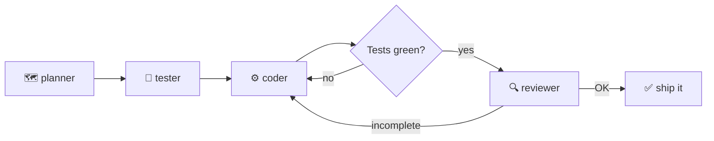

# ai-starter

**Ship features with an AI pipeline that plans, tests, codes, and reviews — you bring the stack.**

ai-starter is a stack-agnostic template for building apps with [Claude Code](https://claude.com/claude-code).
It ships **zero application code**. What it ships instead is the thing that's actually hard
to get right: a *disciplined way of working with AI* — a four-agent pipeline with quality
gates, living docs that keep the AI on-spec, and guardrails that make it mechanically
impossible to end a session with red tests.

> Extracted and generalized from a real production project. The value is the
> **methodology**, not a framework — which is exactly why it works across wildly
> different stacks.

## Why this exists

Anyone who's built with AI agents knows the failure modes:

- 🌀 **Scope creep** — the AI "helpfully" builds features nobody asked for.
- 🧪 **Self-graded homework** — the same agent writes the code *and* decides it's correct.
- 💸 **Paying premium rates for trivial work** — every one-liner burns top-tier model tokens.
- 🗿 **Stale knowledge** — the AI codes against a library API that changed two majors ago.

ai-starter attacks each one structurally, not with wishful prompting:

| Failure mode | Countermeasure |
|---|---|
| Scope creep | A living `SPEC.md` with an explicit **Out-of-scope** section the reviewer enforces |
| Self-graded homework | **Separation of powers**: tests are written *before* the code, by a different agent; a read-only reviewer holds the final gate |
| Token burn | **Automatic model routing** — the planner rates each feature `[S]`/`[M]`/`[L]` and cheap work runs on cheap models, with auto-escalation if the coder gets stuck |
| Stale knowledge | **context7 MCP** pulls current library docs on demand; a **Stop hook** blocks any turn that ends with failing tests or broken types |

## How it works

One command — `/feature <description>` — runs **one cycle per feature**:



- **planner** *(read-only, always top-model)* — turns your request into a concrete plan and
  rates its complexity, which picks the model for the rest of the cycle.
- **tester** — writes failing logic-only tests first (real TDD red, not tests written to
  match the implementation).
- **coder** — implements until green. If it stalls, the orchestrator re-spawns it on a
  stronger model automatically.
- **reviewer** *(read-only, always top-model)* — runs tests + type-check, drives a real
  **browser smoke test** via Playwright MCP, and checks the change against the plan, the
  domain rules, and Out-of-scope. Verdict: APPROVED or back to the coder.

Small, low-risk change? Skip the ceremony — edit directly; the Stop hook still gates the
result.

## Quick start

```bash
npx degit <your-user>/ai-starter my-app    # or: "Use this template" on GitHub
cd my-app
git init && git add -A && git commit -m "Start from ai-starter"
claude
```

Then, in conversation with Claude:

1. **Pick a stack** (guide below) — this template doesn't care if it's Vite, Next, or Expo.
2. **Fill the docs** — `CLAUDE.md` (stack, commands, architecture, domain rules),
   `SPEC.md` (goal + first features + Out-of-scope), `TESTING.md` (verification layers).
3. **Scaffold** the framework, the single data-access layer, and the test runner; fill the
   two commands in `.claude/hooks/verify.sh`. Commit.
4. **Build**: `/feature <description>` — and let the pipeline do its thing.

Want to see it run before committing to it? [**FIRST-RUN.md**](FIRST-RUN.md) is a scripted
15-minute end-to-end verification on a tiny real app.

<details>
<summary><b>Stack decision guide</b></summary>

| If the app is… | Pick | Why |
|---|---|---|
| **Web-first, with iOS/Android as the *same* app in the stores** | **Vite + React + TS, Tailwind + shadcn/ui, Capacitor** | One web codebase; Capacitor wraps it natively. Best for tools / SaaS / CRUD where native "feel" isn't the headline. |
| **Mobile-first, native apps are the product** | **Expo / React Native (+ react-native-web)** | One RN codebase → iOS + Android natively, web for free. |
| **Web only, no app stores** | **Vite/Next + React + TS, Tailwind + shadcn/ui** | Skip the native wrapper entirely. |
| **Backend / accounts / sync needed** | add **Supabase** (or similar) *behind the data layer* | Keep the single data-access layer; default to local-first and swap the implementation when a project actually needs sync. |

</details>

## What's inside

```
.claude/agents/         The feature pipeline (each file is that agent's contract):
  planner.md            → read-only: request → concrete plan + complexity rating
  tester.md             → TDD red: failing logic-only tests
  coder.md              → implements until green
  reviewer.md           → read-only gate: tests + types + browser smoke → verdict
.claude/commands/
  feature.md            → /feature — the orchestrator with the gate loop
.claude/hooks/
  verify.sh             → Stop hook: type-check + tests when a turn ends
.claude/settings.json   Shared permission allowlist + Stop hook wiring
.mcp.json               Playwright (browser smoke) + context7 (live library docs)
CLAUDE.md               Project guidance the agents read. Has slots to fill at bootstrap.
SPEC.md                 Living spec — including Out-of-scope and Limits.
TESTING.md              Layered verification + manual test plan template.
FIRST-RUN.md            Scripted pipeline demo. Delete in real projects.
```

## The three load-bearing ideas

1. **An orchestrated pipeline, not a monologue.** One cycle per feature; plans and reviews
   are read-only; the gate loop sends incomplete work back instead of shipping it.
2. **One data-access layer.** All reads/writes go through a single layer declared in
   `CLAUDE.md` — which is what keeps the backend swappable (local-first today, hosted
   tomorrow) without touching the UI.
3. **A spec that says no.** `SPEC.md`'s Out-of-scope section is the cheapest known cure
   for AI over-building — and the reviewer actually enforces it.

## Conventions worth keeping

- **Logic-only unit tests.** Pure logic gets unit tests; UI is verified by the reviewer's
  Playwright browser smoke, native behavior by running the app per `TESTING.md`. No
  brittle component tests.
- **Update the spec.** Every significant decision lands in `SPEC.md`.
- **The agents stay stack-agnostic.** They defer every concrete detail to your
  `CLAUDE.md` — fill it once and they behave as if hand-written for your stack.
