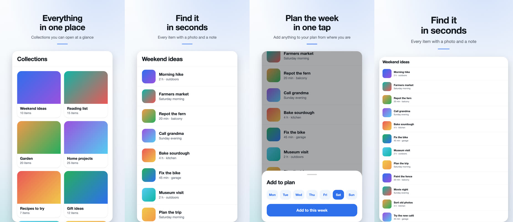
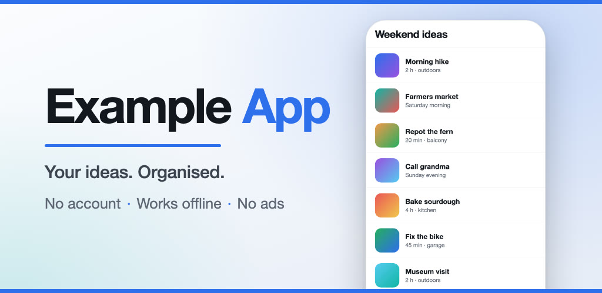
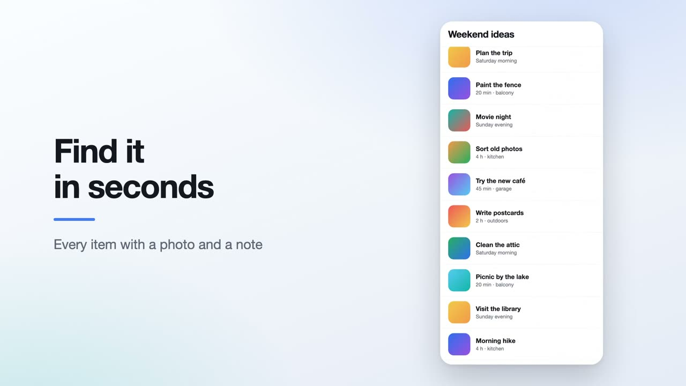
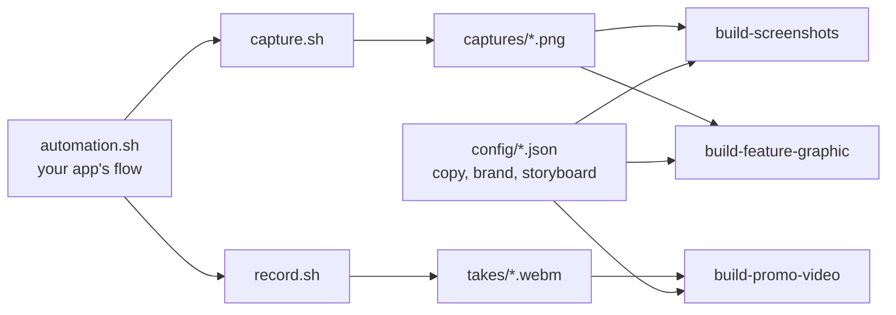

# Android Play assets (optional workflow)

Tools that turn a running Android app into a finished Google Play listing: framed
screenshots for phone and tablet, the feature graphic, and a promo video — in every
language the listing is published in, rebuilt with one command when the copy changes.

It is opt-in and stack-agnostic. It does not build your app, does not upload to Play,
and carries no product's data, copy, package name or coordinates: everything about
your app lives in four JSON files and one bash adapter.





*Rendered from the bundled example project. The "app" in these is a mock-up — see
[Try it without an app](#try-it-without-an-app). For the real thing, see the screenshots
and trailer on
[KeepTaste's Play listing](https://play.google.com/store/apps/details?id=com.damianmalecki.keeptaste):
they were made with the scripts this workflow was generalized from.*

## What it produces

| Asset | Tool | Output | Play Console slot |
|---|---|---|---|
| Screenshot frames | `build-screenshots.mjs` | JPEG per form × locale × screen | Phone / 7-inch / 10-inch screenshots |
| Feature graphic | `build-feature-graphic.mjs` | 1024×500 PNG per locale | Feature graphic |
| Promo video | `build-promo-video.mjs` | 1920×1080 mp4 per locale | Video (as a YouTube URL) |

The inputs are raw material shot from an emulator:

| Input | Tool | What it is |
|---|---|---|
| Captures | `capture.sh` | Plain PNG screenshots of app screens |
| Takes | `record.sh` | Screen recordings of scripted interactions |



The split matters: **copy is a layer of the render, not part of the capture.** Changing
a headline is a JSON edit and a rebuild — the emulator is only needed when the app's UI
or demo content changes.

## Requirements

- **Node 18+** — no npm dependencies.
- **ffmpeg and ffprobe** — compositing, encoding, audio.
- **A Chrome to render with** — `npx playwright install chromium-headless-shell` is the
  reliable choice. An installed Google Chrome also works; `CHROME_BIN` overrides the lookup.
- **Android SDK platform-tools (`adb`) and an emulator** — only for `capture.sh` and
  `record.sh`. Recording uses the emulator console, so it does not work on a physical device.

Developed and tested on macOS. Linux browser paths are included but untested.

## Try it without an app

```bash
node scripts/make-sample-inputs.mjs   --config config/project.example.json
node scripts/build-screenshots.mjs    --config config/project.example.json
node scripts/build-feature-graphic.mjs --config config/project.example.json
node scripts/build-promo-video.mjs    --config config/project.example.json
```

`make-sample-inputs.mjs` fabricates captures and takes for a made-up app so the three
builders have something to work on. Results land in `artifacts/store-assets/output/`.
A real project never runs it.

## Set up for your app

Copy this directory into your project, then:

1. **`config/project.json`** — copy `project.example.json`. Set the package id, the
   locales, the emulator serial, your brand colours and the capture sets (below). Drop the
   `specs` block; the defaults are `config/screenshots.json`, `config/feature-graphic.json`
   and `config/storyboard.json`.
2. **`config/screenshots.json`, `feature-graphic.json`, `storyboard.json`** — copy the
   examples and write your screens, scenes and copy.
3. **`project/automation.sh`** — copy `automation.example.sh` and implement the app's flow.
4. Start the app on an emulator **with `-gpu host`** and gesture navigation, then shoot,
   record and build:

```bash
bash scripts/capture.sh config/project.json en 01-home 02-list 03-plan
bash scripts/record.sh  config/project.json en browse plan
node scripts/build-screenshots.mjs
node scripts/build-feature-graphic.mjs
node scripts/build-promo-video.mjs
```

Every builder takes `--locale <id>` to build one language, and `build-screenshots.mjs`
takes form names (`phone`, `tablet10`) to build one form.

### Capture sets

A capture set describes one kind of raw capture: its pixel size and the rows of *system*
UI at the top and bottom. Every renderer crops those rows off — a stray notification icon
in a store screenshot is the kind of thing nobody spots until it is live.

```json
"captureSets": {
  "phone":  { "width": 1080, "height": 2400, "statusBarRows": 66, "bottomBarRows": 60 },
  "tablet": { "width": 1600, "height": 2560, "statusBarRows": 64, "bottomBarRows": 130 }
}
```

Measure the rows on one capture from your emulator. `capture.sh` and `record.sh` refuse
to run when the device's screen size differs from the set, because every landmark and
crop is measured for that size. Captures are stored as
`<captures>/<set>/<locale>/<screen-id>.png`; pick the set with `CAPTURE_SET=tablet`.

Tablet slots want real tablet captures. A 7-inch and a 10-inch form can share one tablet
capture set — at the same width in dp the app lays out identically, and only the canvas
differs — but phone captures scaled into a tablet slot are exactly what those slots exist
to rule out.

### The adapter

`project/automation.sh` is the only place that knows your app. The scripts call:

| Function | When | Does |
|---|---|---|
| `prepare_demo <locale>` | once per run | reset to a repeatable showcase state |
| `wait_ready` | after it | block until the home screen is really there |
| `capture_screen <locale> <id>` | per capture | navigate to one still |
| `before_scene <locale> <id>` | per take, optional | navigation that should not be in the shot |
| `record_scene <locale> <id>` | per take | the action, performed while recording |

It is sourced after `scripts/lib/adb.sh`, which gives it `tap`, `drag`, `back`,
`type_text`, `tap_ui`, `pixel`, `wait_for_pixel`, `app_restart`, `app_clear`, `open_link`
and `demo_status_bar`.

Run with `SKIP_PREPARE=1` to leave the app as it is. That is how a still is composed by
hand — scroll to the right place, open the sheet, then
`SKIP_PREPARE=1 bash scripts/capture.sh config/project.json en 03-plan`.

### Screenshots

`config/screenshots.json` lists the forms (canvas size, capture set, frame width as a
fraction of the canvas) and the screens with a headline and subline per locale. The
config is checked against Play's rules before anything renders: each side 320–3840 px,
aspect ratio between 16:9 and 9:16, 2–8 screens, copy present for every locale.

- A `\n` in a headline is a line break. Nothing shrinks text to fit: keep headlines to two
  short lines and look at the result.
- `"align": "bottom"` anchors the capture to the bottom of the frame instead of the top.
  The frame is shorter than the capture, so by default the bottom is clipped — which hides
  a bottom sheet. No amount of scrolling moves a sheet up; this does.

### Promo video

`config/storyboard.json` is a list of scenes. A **card** (`card`, `durationMs`) is a
still with centred copy and the app icon; a **take** scene (`take`, `inMs`, `outMs`)
shows that range of a recorded take in a device frame beside its copy. One take can feed
several scenes.

Pick `inMs`/`outMs` from a contact sheet rather than by scrubbing:

```bash
bash scripts/contact-sheet.sh artifacts/store-assets/takes/en/browse.webm
```

The build fails if a scene runs past the end of its take — ffmpeg would otherwise freeze
on the last frame, which is easy to miss in a 30-second video.

**Music.** Put a track at `paths.music` or pass `--music file.mp3`. The excerpt starts
after any leading silence (or at `--music-start <seconds>`), is levelled to −17 LUFS
without letting the peak pass −1.5 dBFS, and fades in and out. The licence is yours to
check: a store listing is commercial use.

## Lessons this encodes

Each of these cost a wasted recording session once.

- **Wait for a pixel, not for a time.** A cold start can take 20 s on a busy host. Taps
  sent into the splash screen land on whatever appears next, and the result looks
  plausible until you watch it. `wait_for_pixel` polls for a known colour at a known spot.
- **`adb emu screenrecord`, not `adb shell screenrecord`.** On an emulator the on-device
  recorder can write a single frame. The console recorder writes a proper `.webm`.
- **`-gpu host`.** Without it the emulator renders about 6 fps. `record.sh` reports each
  take's frame rate and warns under 15.
- **Pin the device.** With two emulators up, "the only device" is how a take gets recorded
  on the one that was never reset. The serial comes from the config, for every call.
- **Clearing app data brings one-time hints back.** Burn them in `before_scene`.
- **Address captures by screen id.** Screens are numbered in listing order; inserting one
  renumbers the rest, and a hard-coded filename only fails at the next build.
- **One palette.** Screenshots, feature graphic and video share `brand` from the config.
  When each renderer carried its own colours, they drifted apart.

## Before you upload

Look at every frame and watch every take: the right locale, no personal data, no
notifications, no third-party brand names or garbled lettering in demo photos, and
headlines that say what the frame shows. Check the rights to images and music. Screenshots
and the feature graphic are uploaded by hand in Play Console (Grow → Store presence →
Main store listing), per language; the video goes to YouTube and its URL into the same
page. Neither needs a new app build.

## Layout

```
config/      project.json + screenshots, feature-graphic and storyboard specs (examples included)
project/     automation.sh — your app's adapter (git-ignored; the example is tracked)
scripts/     capture.sh, record.sh, contact-sheet.sh, build-*.mjs, make-sample-inputs.mjs
scripts/lib/ brand, layout, templates, render, video, config, cli, project; adb.sh, session.sh
tests/       unit tests for the pure logic
artifacts/   captures, takes and output (git-ignored)
```

## Tests

```bash
node --test tests/*.test.mjs
```

They cover config validation, layout geometry, the ffmpeg filter graphs and the audio
measurements, and need no emulator, browser or ffmpeg.
